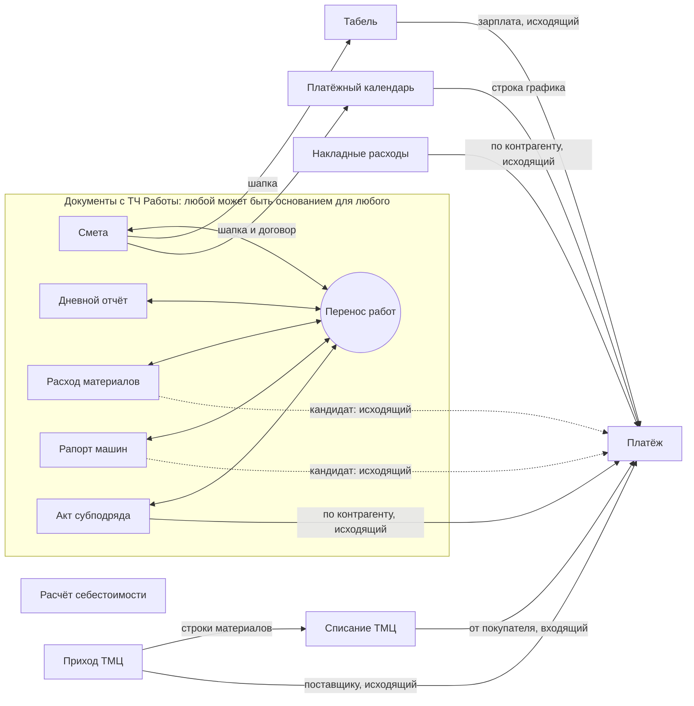

# CTM — единый план разработки и gap-анализ

Актуальность: 2026-09-02. Источник истины для статусов — текущие исходники в
`current/api` и `current/web-client`; старые AS-IS-разделы спецификаций сами по
себе не считаются подтверждением отсутствующей функции. Полная трассировка и
доказательства: `SPEC_REVIEW.md`; security baseline: `SECURITY_BASELINE_SPEC.md`.

## 1. Зачем появился этот документ

В репозитории есть подробные спецификации отдельных подсистем и журнал
исправлений, но нет единого актуального roadmap. Некоторые старые планы уже
расходятся с кодом: например, endpoint оборотов взаиморасчётов, серверная
пагинация регистра работ, инженерные таблицы и обмен строками сметы уже
реализованы. Этот документ сводит подтверждённое состояние и оставшуюся работу.

Статусы:

- **Готово** — функция найдена в API и UI либо подтверждена тестом.
- **Частично** — основной сценарий есть, но часть критериев спецификации не закрыта.
- **Gap** — заявленная функция отсутствует или содержит подтверждённый дефект.
- **Решение** — требуется продуктовое/учётное решение до реализации.

## 2. Текущий срез

| Область | Статус | Подтверждение и остаток |
|---|---|---|
| Документы и списки | Частично | 11 списков используют общий механизм сортировки, фильтров, настроек, команд и «ввода на основании». Не закрыты перенос строк основания, полный диалог отбора, resize/freeze и экспорт списка. |
| Формы документов | Частично | CRUD/lifecycle 11 коллекций и запрет редактирования проведённых документов покрыты backend-тестами; Playwright проверяет login/session, сохранение сметы, проведение/отмену, роли и dirty-state. Остаётся расширить real-backend E2E на остальные формы и сценарии «на основании». |
| Обмен строками | Частично | Для шести типов реализованы RBAC, lifecycle guard, лимиты, транзакционный preview/apply и sync-регистрация; smoke-тест проверяет двухшаговый UI. Табель и ТМЦ остаются отдельными реализациями; профиль авто-создания материалов ТМЦ не применяется автоматически. |
| Регистр работ | Готово в объёме P0 | Count, totals, grouping и page выполняются в SQL; CSV/XLSX выгружают полный отфильтрованный набор. Контракты >50 строк покрыты тестами. PDF остаётся P2. |
| Себестоимость и отчёты | Частично | CRUD, распределение, расчёт, четыре отчёта и drilldown присутствуют. R-REP1 закрыт: карточка включает распределённые накладные, итоги карточки, рентабельности и калькуляции сходятся на fixture-данных. Остаются: объёмный RBAC-контур чтения для прораба и отрицательные UI/E2E сценарии. |
| ТМЦ и взаиморасчёты | Готово по старому parity-плану, без регрессионных тестов | Формы ТМЦ, остатки, ОСВ, просрочки, профили импорта и подсказки платежей найдены в API/UI. Старый `PARITY_PLAN` требует архивной пометки. |
| Инженерные таблицы | Частично | Просмотрщик, безопасная query-консоль, сохранение запросов через user settings, CSV и печать реализованы. Нет XLSX, параметров, истории и автоматических security-тестов. |
| Импорт расценок Минстроя | Gap | Есть спецификация, но в исполняемых исходниках реализация не найдена. |
| Обновление цен при импорте накладных | Gap | Есть спецификация, но policy/API/UI реализации в исходниках не найдено. |
| Автоматические тесты/CI | Готово в объёме P0 | 32 backend-теста и 31 Playwright-тест запускаются одной командой `python verify.py`; GitHub Actions выполняет syntax/tests/typecheck/build/E2E и сохраняет диагностику при сбое. |

## 3. Подтверждённые функциональные gaps

### P0 — доверие к данным и поставке

1. **Автоматизированный backend-контур.** Добавить `pytest` + FastAPI `TestClient`
   с временной SQLite БД. Первыми покрыть auth, CRUD и lifecycle всех документов,
   запрет редактирования проведённых документов, распределение накладных,
   калькуляцию, отчёты, drilldown, импорт/экспорт и синхронизацию.
2. **Детерминированный учётный сценарий.** Перенести сценарий из
   `TESTING_PLAN.md` в fixtures и проверять точные суммы, penny balancing и
   межотчётную сверку.
3. **Frontend E2E основных потоков.** Восстановить реальный login-тест и добавить
   создание → сохранение → проведение → отмена проведения, права ролей,
   dirty-state, списки/фильтры, «ввод на основании» и импорт файлов.
4. **CI quality gate.** На каждый change запускать Python syntax/tests,
   `vue-tsc`, production build и Playwright smoke. Публиковать trace/report при
   падении.
5. **Безопасность конфигурации.** Ротировать попавшие в Git credentials, удалить
   рабочие fallback-пароли, запретить production startup с dev JWT secret, пустым
   sync token и demo seed (`SECURITY_BASELINE_SPEC.md`).
6. **Безопасный импорт.** Запретить import в проведённые/распределённые документы,
   ввести RBAC, проверку существования документа и атомарный preview/apply.
7. **Регистр работ.** Перенести count/group/page в SQL и гарантировать полный
   экспорт текущего отфильтрованного представления, включая наборы > 50 строк.

Критерий завершения P0: чистый checkout разворачивается одной документированной
командой; все обязательные проверки выполняются без внешней тестовой БД и
блокируют регрессию.

### Статус поставки P0 на 2026-09-02

Репозиторная часть P0 реализована. Команда `python verify.py --install` поднимает
зависимости и выполняет проверки на временной SQLite БД. В тестовый контракт
входят auth/session, CRUD 11 коллекций документов, lifecycle девяти проводимых
типов, точный сценарий распределения и отчётов, атомарный импорт, sync-token,
SQL-пагинация и полные CSV/XLSX-выгрузки регистра. Browser smoke покрывает login,
сохранение и dirty-state сметы, фильтр списка, role visibility, post/unpost и
preview/apply импорта.

Остаётся одна внешняя операция, которую нельзя выполнить изменением репозитория:
администратор должен ротировать ранее использовавшиеся SSH credentials и затем
задать новые значения только через защищённое окружение. Встроенные fallback
значения удалены, production startup теперь fail-closed. Ответы раздела 7 нужны
для RBAC и «ввода на основании» следующих итераций, но не блокируют этот P0.

### P1 — корректность учёта и безопасность

1. **R-REP1: накладные в карточке себестоимости.** Включить
   `overhead_distribution` в `get_cost_card` и обеспечить равенство итогов
   карточки, рентабельности и калькуляции.
2. **Реальная договорная стоимость.** Брать договорную стоимость из сметы,
   связанной с расчётом через договор: для разреза объект × договор × работа
   определить договорную расценку по строкам сметы и умножить её на выполненный
   объём. Не допускать произвольного выбора строки при нескольких сметах/строках
   одной работы; правило агрегации закрепить fixture-тестом.
3. **Труд табеля по работам.** Устранить posting с `work_id = 0`; определить
   обязательный источник работы или правила распределения труда.
4. **Аудит пользователя.** Передавать `current_user.id/username` во все операции
   `_audit_log`; не скрывать систематические ошибки аудита без наблюдаемости.
5. **Единая авторизация writes.** Выбрать один из вариантов RBAC из раздела 7.2,
   зафиксировать матрицу ролей для create/update/delete/restore cost-документов
   и синхронизировать backend guards с UI.
6. **R-REP2/R-REP3.** Сделать выбор элемента затрат детерминированным. Во всех
   отчётах учитывать помеченные на удаление элементы затрат, если на них есть
   учётные данные; пометка справочника не должна менять исторические итоги.
7. **State machine калькуляции.** При отмене проведения удалять рассчитанный
   результат и возвращать документ в `draft`. Закрепить уже выбранное поведение
   в модели, UI и тестах.

Критерий завершения P1: детерминированные fixture-тесты сходятся между всеми
отчётами; аудит содержит автора; отрицательные сценарии прав возвращают 403.

### Статус поставки P1 на 2026-09-02

Реализованы и покрыты backend-тестами (`api/tests/test_cost_decisions.py`,
`api/tests/test_cost_lifecycle_guards.py`, `api/tests/test_accounting_scenario.py`):

- **RBAC=B (п. 5):** прораб ведёт только собственные полевые документы
  (владелец проверяется в API на create/update/delete), офисные документы и
  lifecycle-команды — `admin`/`manager`; restore добавлен для всех пяти
  cost-документов; delete/restore запрещены для проведённых и распределённых
  документов; отрицательные сценарии возвращают 403/400.
- **Аудит (п. 4):** все cost lifecycle-операции (post/unpost/delete/restore,
  распределение и отмена накладных, расчёт) пишут `audit_logs` с id и username
  действующего пользователя; добавленные записи delete/restore ранее не
  фиксировались вовсе.
- **Договорная стоимость (п. 2):** выполненный объём берётся из
  `work_execution_register`, договор — через смету; расценка средневзвешенная по
  сметному объёму; нулевой объём, разные расценки и отсутствие проведённой сметы
  дают диагностируемые предупреждения. Закреплено fixture-тестами.
- **R-REP1 (п. 1):** карточка себестоимости включает `overhead_distribution`
  в элементе затрат `overhead`; равенство итогов карточки, рентабельности и
  калькуляции проверяется на детерминированном сценарии (164 000 + 12 000).
- **R-REP2/R-REP3 (п. 6) и state machine калькуляции (п. 7):** помеченные
  элементы затрат сохраняют исторические суммы во всех отчётах, выбор элемента
  детерминирован, отмена проведения удаляет результат и возвращает `draft`.

### Статус P1 после сессии 2026-09-03

Дополнительно закрыты и проверены:

- **Обход RBAC вне HTTP:** sync-runtime не содержит cost-сущностей (ENTITY
  maps покрывают только справочники и старые семейства документов); import-text
  для cost-документов ограничен `admin`/`manager` и отклоняет
  проведённые/распределённые/помеченные цели (409/404); других вызывающих
  lifecycle-сервисов нет. Отрицательный тест: прораб получает 403 на импорт.
- **Диагностика труда табеля:** расчёт предупреждает о нераспределённом по
  работам труде (`work_id = 0`) вместо молчаливой фантомной строки; суммы не
  меняются. Само правило — открытое решение 7.4.
- **Отрицательные UI/E2E сценарии:** Playwright-набор `rbac-cost.spec.ts`
  (4 теста) проверяет списки полевых/офисных документов и форму акта субподряда
  для прораба и менеджера.
- **PostgreSQL parity:** тестовый режим `CTM_TEST_DB=postgresql` в conftest
  (временная база на тест) готов к запуску одной командой; выполнение в этой
  среде заблокировано отсутствием сервера (локальная сборка 1C без initdb-файлов,
  Docker-демон остановлен).

Остаток P1: выбор правила труда табеля (раздел 7.4); решение об объёме чтения
для прораба; фактический прогон parity на доступном PostgreSQL; допсоглашения
как отдельные/дочерние договоры в договорной стоимости.

### P2 — завершение уже начатых спецификаций

1. **Обмен данными.** Унифицировать табель там, где формат это позволяет;
   подключить `create_missing_materials/create_missing_units` в импорт ТМЦ;
   покрыть иерархический импорт/экспорт сметы тестами; явно оставить калькуляцию
   вне обмена как документ без редактируемых строк.
2. **Ввод на основании.** Утвердить предложенный реестр из раздела 7.3 и
   реализовать перенос табличных частей по детерминированным правилам сопоставления,
   сохраняя трассировку основания и предупреждения о незаполненных полях.
3. **Списки документов.** Реализовать экспорт текущего представления, resize с
   сохранением ширин; затем решить необходимость freeze, множественной сортировки
   и полного диалога «Отбор и сортировка».
4. **Регистр работ.** После исправления SQL-пагинации и полного экспорта добавить
   печатное представление/PDF и acceptance-тесты пагинации, фильтров, экспорта и
   перехода к регистратору.
5. **Drilldown.** Добавить экспорт, индексы по часто используемым фильтрам и тесты
   L1 → L2 переходов для каждого registrar type.
6. **Инженерная консоль.** Добавить XLSX-экспорт и security/performance-тесты;
   параметры, CodeMirror, T-SQL адаптер и общую библиотеку запросов оставить
   отдельными опциональными итерациями.

### P3 — новые продуктовые возможности

1. **Обновление цен материалов при импорте накладной.** Реализовать
   `PRICE_UPDATE_ON_IMPORT_SPEC.md`: preview, явная политика обновления,
   подтверждение пользователя, аудит и правила синхронизации.
2. **Импорт ФЕР/ГЭСН Минстроя.** Реализовать
   `MINSTROY_PRICELIST_IMPORT_SPEC.md`: parser/preview, индексы пересчёта,
   иерархию групп, разрешение конфликтов и идемпотентность.

Эти две возможности не следует начинать до P0: обе массово изменяют справочники
и требуют надёжных rollback/fixture-тестов.

## 4. Технический долг и документация

1. Пометить устаревшие AS-IS матрицы датой проверки или заменить ссылкой на этот
   документ. В частности, обновить `TEXT_IMPORT_EXPORT_SPEC.md` (смета уже имеет
   отдельный обмен) и старый web↔desktop parity-план.
2. Исправить E2E-документацию: `login.spec.ts` заявлен, но отсутствует; текущий
   Playwright-набор не требует отдельного backend для layout-тестов.
3. Зафиксировать поддерживаемые SQLite/PostgreSQL сценарии и прогонять один и тот
   же contract suite на обоих диалектах для критичных запросов.
4. Разделить крупные сервисные модули по доменам после появления characterization
   tests; до тестов такой рефакторинг рискован.
5. Для каждого нового spec добавлять поля: владелец, статус, дата последней
   проверки по коду, зависимости, тесты и миграционный/rollback-план.

## 5. Порядок поставки

| Итерация | Результат | Зависимости |
|---|---|---|
| 0. Security containment | ротация секретов, fail-closed production config, sync auth | нет |
| 1. Test foundation | pytest fixtures, API contract tests, восстановленный login E2E, CI | итерация 0 |
| 2. Data integrity | безопасный import, полный export регистра, SQL pagination, lifecycle/RBAC | итерация 1 |
| 3. Accounting correctness | R-REP1/2/3, contract value, timesheet work attribution, audit/state machine | итерации 1–2 |
| 4. Existing-spec closure | обмен ТМЦ/табеля/сметы, ввод на основании со строками, списки и регистр | итерации 1–3 |
| 5. Engineering hardening | security/performance matrix, hard row cap, XLSX, PostgreSQL parity | итерации 1–2 |
| 6. Price update import | политика обновления цен с preview/audit/sync | итерации 1–3 |
| 7. Minstroy import | массовый каталог ФЕР/ГЭСН с conflict handling | итерации 1–3 |

## 6. Definition of Done для каждой задачи

- Требование связано с конкретной спецификацией или issue.
- Есть позитивный, негативный и граничный автоматический тест.
- Миграция идемпотентна и имеет проверенный rollback/backup-путь, если меняется БД.
- Backend проверяет права и входные данные независимо от UI.
- Frontend показывает loading/error/empty state и не допускает повторной отправки.
- `pytest`, `vue-tsc`, production build и релевантный Playwright-набор проходят.
- Документация и status-матрица обновлены одновременно с кодом.

## 7. Принятые решения и вопросы, блокирующие отдельные задачи

### 7.1. Принятые решения

1. **Источник договорной стоимости:** смета, связанная через договор. Расчёт
   выполняется в разрезе объект × договор × работа. Базовое правило:
   `договорная стоимость = выполненный объём × договорная расценка из сметы`.
   Если одна работа встречается в нескольких строках связанной сметы, договорная
   расценка определяется как средневзвешенная по сметному объёму; нулевой объём
   или несколько противоречивых смет должны давать диагностируемое предупреждение,
   а не недетерминированный выбор первой строки.
2. **Помеченные элементы затрат:** отчёты учитывают их наравне с активными, если
   на элемент есть плановые, фактические или распределённые суммы. Исторические
   показатели после пометки элемента не меняются.
3. **Отмена проведения калькуляции:** строки результата удаляются, статус
   становится `draft`; для повторного проведения требуется заново выполнить
   расчёт. Это соответствует текущему поведению сервиса и должно быть закреплено
   контрактным и UI-тестами.

### 7.2. Варианты RBAC для cost-документов

Во всех вариантах `admin` имеет полный доступ. Чтение и экспорт можно оставить
всем аутентифицированным пользователям с ограничением по доступным объектам;
таблица ниже относится к созданию и редактированию черновиков.

| Документ | Вариант A — простой | Вариант B — по процессу (рекомендуемый) | Вариант C — отдельные полномочия |
|---|---|---|---|
| Расход материалов | `admin`, `manager` | `admin`, `manager`, `foreman` — прораб только свои документы/объекты | `cost.field.edit` |
| Рапорт о работе машин | `admin`, `manager` | `admin`, `manager`, `foreman` — прораб только свои документы/объекты | `cost.field.edit` |
| Акт приёмки субподрядных работ | `admin`, `manager` | `admin`, `manager` | `cost.subcontract.edit` |
| Накладные расходы | `admin`, `manager` | `admin`, `manager` | `cost.overhead.edit` |
| Расчёт себестоимости | `admin`, `manager` | `admin`, `manager` | `cost.calculation.edit` |

- **A — простой:** минимальная доработка и единое правило, но прораб не сможет
  самостоятельно оформить полевые документы.
- **B — по процессу (рекомендуемый):** прораб оформляет только собственный расход
  материалов и использование машин; офисные и расчётные документы остаются у
  менеджера. Нужны проверки владельца (`foreman_id = current_user.person_id`) и
  доступности объекта как в API, так и в UI.
- **C — отдельные полномочия:** роли получают набор capabilities; это гибче для
  организаций, где сметчик, бухгалтер и ПТО — разные сотрудники, но требует
  новой модели прав и интерфейса назначения.

Для варианта B предлагается: create/update/mark-for-deletion своего черновика —
по таблице; restore, массовый import, post/unpost, распределение накладных и
расчёт — `manager`/`admin`; административная правка проведённого документа не
разрешается, вместо неё используется отмена проведения с аудитом.

**Принятое решение P1:** вариант B. Backend является источником проверки прав;
UI должен повторять матрицу доступности. Реализация начата, актуальный handoff и
оставшиеся проверки находятся в `NEXT_SESSION_TODO.md`.

### 7.3. Предлагаемая схема «Ввод на основании»

На схеме показаны все логические виды документов. В UI это 11 списков, но ТМЦ
имеет два отдельных `doc_kind`, поэтому узлов документов двенадцать.

`Расчёт себестоимости` намеренно не имеет входящих/исходящих связей: его строки
формируются только командой «Рассчитать». Связи `Расход материалов → Платёж` и
`Рапорт машин → Платёж` показаны пунктиром, потому что в их шапке сейчас нет
контрагента и договора; без этих реквизитов платёж нельзя заполнить однозначно.
Самоссылки внутри группы ТЧ «Работы» не создаются — для них используется команда
«Копировать».

#### Правила переноса

1. Во всех парах сначала записываются `based_on_type`, `based_on_id` и номер
   основания. Статус проведения, идентификаторы строк, даты проведения и
   рассчитанные итоги никогда не копируются; дата нового документа — текущая.
2. Шапка заполняется по общим реквизитам: объект, смета, организация, контрагент,
   договор, ответственный/прораб. Ссылка переносится только если поле существует
   у документа-результата.
3. Для любой пары внутри группы ТЧ «Работы» создаётся по одной строке результата
   на каждую негрупповую строку источника. Работа переносится по `work_id`; если
   ссылки нет — по единственному точному совпадению нормализованного наименования
   в справочнике работ. Группы переносятся только в результат, который
   поддерживает иерархию.
4. Колонки строки сопоставляются последовательно: одинаковое техническое имя →
   утверждённый словарь синонимов → единственное совпадение нормализованных
   пользовательских наименований. Автоматическое «похожее» совпадение не должно
   молча подменять разные экономические смыслы: неоднозначные поля остаются
   пустыми и попадают в предупреждения preview.
5. После переноса пересчитываются производные поля результата (`sum`, НДС,
   отклонение и итоги); они не копируются из основания. Обязательные специфичные
   поля — материал, машина, исполнитель, контрагент и т. п. — остаются пустыми,
   если их нет в источнике, и подсвечиваются до сохранения/проведения.
6. `Приход ТМЦ → Списание ТМЦ` переносит материал, единицу, количество, цену,
   объект, код чертежа и примечание; доступный остаток проверяется при сохранении
   и проведении результата.
7. Преобразование в платёж не является копированием ТЧ: строка графика или суммы
   основания сворачиваются в реквизиты одного платежа. Если в основании несколько
   контрагентов/договоров, пользователь сначала выбирает строку либо система
   создаёт отдельный черновик платежа для каждой однозначной группы.

### 7.4. Открытое решение: труд табеля по работам (P1 п. 3)

Табель сейчас постится в `actual_costs` с `work_id = 0` (строки табеля не
содержат работы). Расчёт себестоимости с 2026-09-02 выводит предупреждение
«Timesheet labor is not attributed to works» вместо молчаливой фантомной строки,
но само правило распределения не выбрано. Варианты:

- **A — обязательная работа в строке табеля:** добавить `work_id` в
  `timesheet_lines` (схема, модель, UI, sync). Детализация честная, но меняет
  сценарий заполнения табеля и требует миграции существующих строк.
- **B — распределение по смете:** распределять труд строки по работам связанной
  сметы пропорционально `planned_labor` строк сметы. Не меняет ввод, но это
  учётная политика: пропорции сметы становятся основой факта.

До выбора варианта posting сохраняет текущее поведение (объектный уровень) с
предупреждением в расчёте; тест `test_calculation_warns_about_unattributed_timesheet_labor`
фиксирует и диагностику, и неизменность сумм.

**Открытые решения P2:** подтвердить полный граф между пятью документами с ТЧ
«Работы»; подтвердить пунктирные связи; выбрать поведение для основания с
несколькими контрагентами (выбор строки или несколько черновиков).

Принятые ответы нужны для P1/P2/P3, но не блокируют начало тестового фундамента
P0. До утверждения варианта RBAC и оставшихся связей соответствующие тесты
помечаются как decision-pending, а не подменяются случайным текущим поведением.
